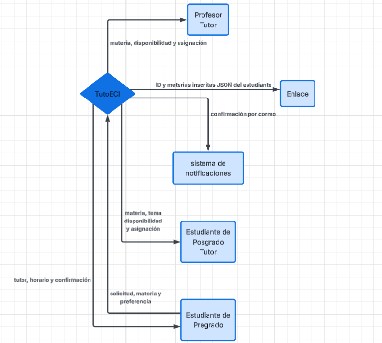
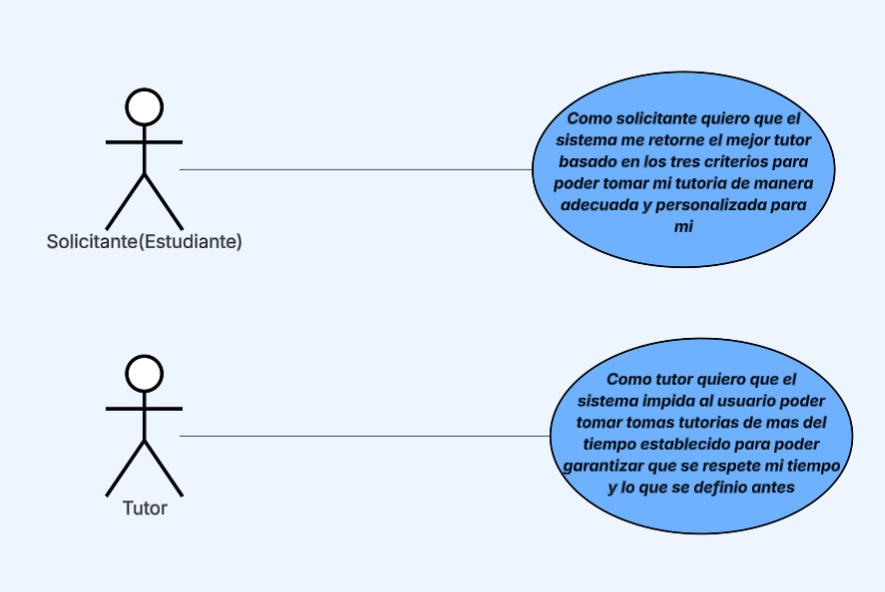
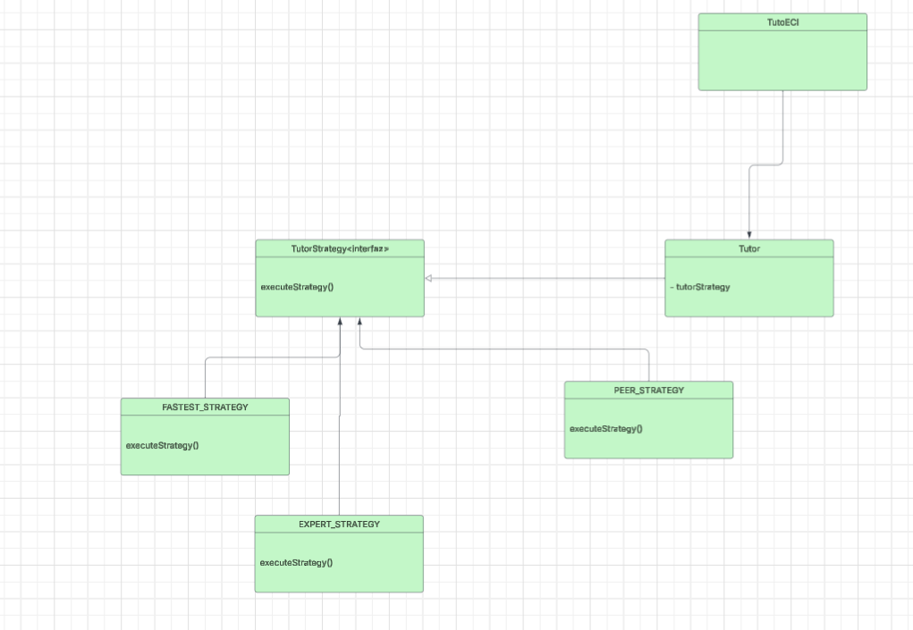

# DOSW_ParcialT1_DanielSua

##  Diagrama de contexto

## Requerimientos

#### Funcionales
1. El sistema debe notificar al usuario al momento de que se valide exitosamente su reserva
2. El sistema debe tener reglas para la gestion y toma de tutorias tales como:
    * Solo permitir solicitar si esta inscrito en la materia
    * Permitir maximo 30 minutos de reserva para tutores profesores y 60 minutos para tutores estudiantes de pregrado
3. El sistema debe retornar al solicitante el mejor tutor disponible basado en tres criterios:
    * FASTEST_AVAILABLE(se busca el mas rapido disponible)
    * EXPERT_FIRST(prioriza profesores)
    * PEER_TUTORING(prioriza tutores)

#### No funcionales
1. Se debe emplear una tipografia legible que cumpla con los estandares minimos de contraste y accesibilidad web
2. El diseño debe incluir la paleta de colores del programa Ingenieria de sistemas y la identidad visual institucional

#### Historias de usuario

| Campo | Descripción |
|------|-------------|
| **ID** | HU-01 |
| **Título** | Notificar al usuario al momento de validar su reserva |
| **Descripción** | *Como tutor me gustaria que se notificara al usuario al momento de validar la reserva para poder avisarle al solicitante que se agendo un espacio para el* |
| **Prioridad** | Media |

| Campo | Descripción |
|------|-------------|
| **ID** | HU-03 |
| **Título** | El sistema debe tener reglas para la gestion y toma de tutorias |
| **Descripción** | *Como tutor  quiero que el sistema impida al usuario poder tomar tomas tutorias de mas del tiempo establecido para poder garantizar que se respete mi tiempo y lo que se definio antes* |
| **Prioridad** | Media |

| Campo | Descripción |
|------|-------------|
| **ID** | HU-04 |
| **Título** | El sistema debe retornar al solicitante el mejor tutor disponible |
| **Descripción** | *Como solicitante quiero que el sistema me retorne el mejor tutor basado en los tres criterios para poder tomar mi tutoria de manera adecuada y personalizada para mi* |
| **Prioridad** | Alta |

**Diagrama de casos de uso**

## Planeacion agile

#### Espacio Jira
[espacio_jira](https://daniel-dosw.atlassian.net/jira/software/projects/TUT/boards/34/backlog?atlOrigin=eyJpIjoiZTU1YmU3YTg3NjQwNGM2Mjg3MTMyMTJjYTY1YzYwMjgiLCJwIjoiaiJ9)

## Diseño de Software y Patrones

Para la estrategia de seleccion de preferencia se puede aplicar el patron de comportamiento strategy esto ya que tenemos distintas formas u opciones de un algoritmo dentro de la seleccion y necesitamos que el sistema pueda cambiar de una opcion a otra durante la ejecucion, cada diferente tipo de seleccion de preferencia se añade una estrategia concreta para resolverla evitando tener una clase monstruosa

Para aislar la interoperabilidad con sistemas externos usaria adapter ya que si tenemos muchos sistemas externos muchos de ellos podrian no ser compatibles con nuestro codigo, una interfaz que haga de intermediario entre el sistema externo y el propio permitiria poder usar las funcionaludades externas pero con nuestro sistema ya implementado, evitando tener que rehacer todo nuestro codigo en funcion del sistema externo

### Diagrama de clases 

Estoy aplicando los principios solid de single responsability porque cada clase se encarga de una sola responsabilidad en este caso la estrategia que usan también uso interface segregation principle porque bajo este orden ninguna clase que implemente una interfaz se ve obligado a usar metodos que no necesita, en este caso todas usan excute_strategy()

